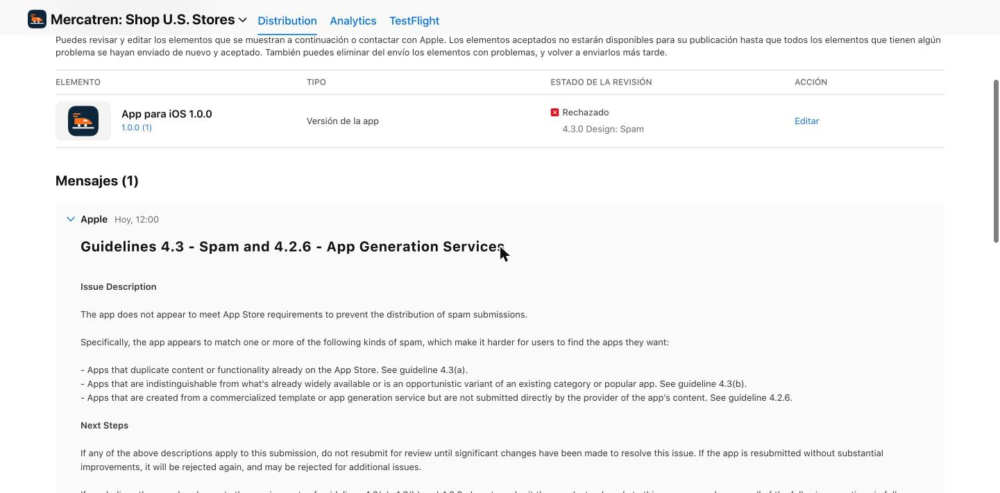
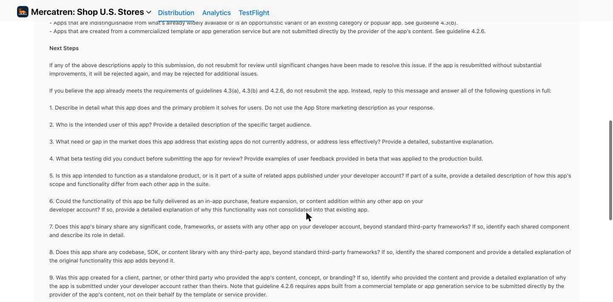
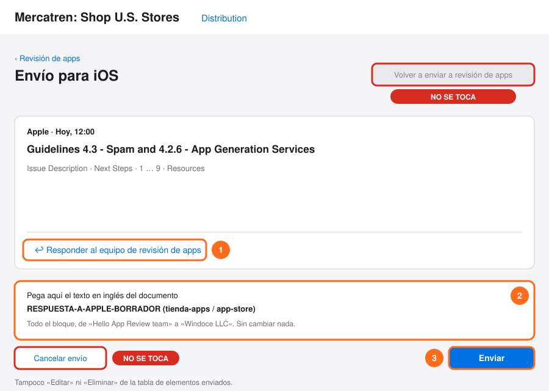
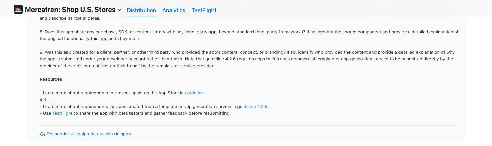

# Tutorial: el rechazo de Apple a la app de Mercatren (3 nov 2026)

> **Hoy no se le manda nada a Apple.** Orden de Richard del 3 nov: ni
> reenviar, ni subir compilaciones, ni cancelar, ni escribirle a Apple hasta
> que él apruebe el estudio común de Gerencia.

## 1. Qué dijo Apple

**Envío:** versión 1.0.0, compilación 1, enviada el 31 oct 2026. **Rechazada**
el 3 nov 2026 a las 12:00 (Miami). En la tabla dice «4.3.0 Design: Spam».

**Cómo se leyó:** la API de App Store Connect, con la llave guardada, solo
devuelve el estado (`REJECTED`, «problemas sin resolver») y no el texto. El
mensaje se leyó en App Store Connect, en la sesión que Richard ya tenía
abierta en su Chrome, **sin escribir contraseñas** y sin tocar ningún botón.




El mensaje literal:

```
Guidelines 4.3 - Spam and 4.2.6 - App Generation Services

Issue Description

The app does not appear to meet App Store requirements to prevent the distribution of spam submissions.

Specifically, the app appears to match one or more of the following kinds of spam, which make it harder for users to find the apps they want:

- Apps that duplicate content or functionality already on the App Store. See guideline 4.3(a).
- Apps that are indistinguishable from what's already widely available or is an opportunistic variant of an existing category or popular app. See guideline 4.3(b).
- Apps that are created from a commercialized template or app generation service but are not submitted directly by the provider of the app’s content. See guideline 4.2.6.

Next Steps

If any of the above descriptions apply to this submission, do not resubmit for review until significant changes have been made to resolve this issue. If the app is resubmitted without substantial improvements, it will be rejected again, and may be rejected for additional issues.

If you believe the app already meets the requirements of guidelines 4.3(a), 4.3(b) and 4.2.6, do not resubmit the app. Instead, reply to this message and answer all of the following questions in full:

1. Describe in detail what this app does and the primary problem it solves for users. Do not use the App Store marketing description as your response.

2. Who is the intended user of this app? Provide a detailed description of the specific target audience.

3. What need or gap in the market does this app address that existing apps do not currently address, or address less effectively? Provide a detailed, substantive explanation.

4. What beta testing did you conduct before submitting the app for review? Provide examples of user feedback provided in beta that was applied to the production build.

5. Is this app intended to function as a standalone product, or is it part of a suite of related apps published under your developer account? If part of a suite, provide a detailed description of how this app's scope and functionality differ from each other app in the suite.

6. Could the functionality of this app be fully delivered as an in-app purchase, feature expansion, or content addition within any other app on your developer account? If so, provide a detailed explanation of why this functionality was not consolidated into that existing app.

7. Does this app's binary share any significant code, frameworks, or assets with any other app on your developer account, beyond standard third-party frameworks? If so, identify each shared component and describe its role in detail.

8. Does this app share any codebase, SDK, or content library with any third-party app, beyond standard third-party frameworks? If so, identify the shared component and provide a detailed explanation of the original functionality this app adds beyond it.

9. Was this app created for a client, partner, or other third party who provided the app's content, concept, or branding? If so, identify who provided the content and provide a detailed explanation of why the app is submitted under your developer account rather than theirs. Note that guideline 4.2.6 requires apps built from a commercial template or app generation service to be submitted directly by the provider of the app's content, not on their behalf by the template or service provider.

Resources

- Learn more about requirements to prevent spam on the App Store in guideline 4.3.
- Learn more about requirements for apps created from a template or app generation service in guideline 4.2.6.
- Use TestFlight to share the app with beta testers and gather feedback before resubmitting.
```

## 2. Por qué pasó (sin adornos)

Leído en las pautas oficiales de Apple (App Review Guidelines) el 3 nov 2026:

- **4.3 Spam.** Apple no acepta apps que repitan lo que ya hay en la tienda o
  que sean una variante más de una categoría llena. Y avisa que los envíos
  repetidos de ese tipo pueden sacar a la cuenta del programa de
  desarrolladores.
- **4.2.6 Apps hechas con plantilla o por un servicio.** Se rechazan si no
  las envía directamente el dueño del contenido; el servicio no debe enviarlas
  a nombre de sus clientes.
- **4.2 Funcionalidad mínima** (no la cita el rechazo, pero es el fondo): una
  app tiene que ofrecer más que un sitio web reempacado.

Lo que de verdad tiene Mercatren y explica el rechazo:

- **La app es el sitio de mercatren.com dentro de una ventana**, con cuatro
  pestañas nativas, el gesto de volver, deslizar para recargar y una pantalla
  sin conexión. Por dentro, todo lo demás es la página web.
- **El mismo molde que otras siete apps de la cuenta**, rechazadas el mismo
  minuto: muchas marcas distintas publicadas por la misma empresa que las
  hace, que es el retrato de la 4.2.6.
- **Una sola compilación en TestFlight** (1.0.0, compilación 1) y **ninguna
  prueba con usuarios externos**: Apple lo pregunta en la 4.
- **Hoy, además, no pasaría la 2.1 (app completa):** el sitio está en pausa
  en YaDominios y el catálogo está vacío desde el 3 nov, por orden de Richard.
  La cuenta de prueba no puede entrar y las notas para el revisor están
  viejas: hablan de «algunos productos en pausa» y hoy está en pausa todo el
  sitio. La 2.1 pide encender el servidor y dar una cuenta de prueba que
  funcione.

**El video.** Para Mercatren **no se grabó ni se adjuntó ningún video**: Apple
no tiene ningún adjunto en la ficha de revisión. Las tres grabaciones de
iPhone que hay en Descargas (1, 2 y 3 nov) son de Kipuu, de otra app de tema
oscuro y de un punto de venta; ninguna es de Mercatren. **Hoy no hace falta
un video nuevo:** este rechazo no pide ninguno. Apple pide responder las
nueve preguntas o hacer cambios importantes, y un video no arregla la 4.3 ni
la 4.2.6. Un video solo serviría más adelante, si el revisor no pudiera probar
algo por su cuenta, y siempre con el sitio activo.

## 3. Qué hicimos nosotros

- **No se reenvió, no se canceló y no se le escribió a Apple.** El envío sigue
  como Apple lo dejó.
- **Se leyó y se guardó el mensaje literal** (arriba) y el análisis en
  `tienda-apps/app-store/RECHAZO-2026-11-03.md`.
- **La respuesta a las nueve preguntas está escrita y sin enviar**, en
  `tienda-apps/app-store/RESPUESTA-A-APPLE-BORRADOR.md`. Sigue la línea común
  de Gerencia (`~/Gerencia/APPLE-4.3-LINEA-COMUN.md`). En la pregunta 9 usa la
  variante para las marcas con sociedad propia, porque Mercatren lo opera
  Mercatren LLC.
- **No se cambió código de la app.** Los cambios de fondo (pantallas propias,
  avisos, sin conexión, pruebas en TestFlight) esperan la decisión de Richard
  y la reactivación de las fábricas.

## 4. Qué tiene que hacer Richard, paso a paso

**Hoy: nada en App Store Connect.** Tu parte, en orden:

1. **Aprobar el estudio común de Gerencia.** Hasta entonces no sale nada.
2. **Decidir cuándo vuelve mercatren.com y con qué productos.** La respuesta
   de Mercatren no puede salir con el sitio en pausa: el revisor abre la app
   al leerla y vería la página de pausa.
3. **El día que salga**, la respuesta se pega así:



- Pantalla: App Store Connect → Mercatren → Distribution → **Revisión de
  apps** → el envío del 31 oct.
- **①** Abajo del mensaje de Apple, toca **«Responder al equipo de revisión de
  apps»**.

  

- **②** En la casilla que se abre, pega **todo** el bloque en inglés del
  documento RESPUESTA-A-APPLE-BORRADOR, de «Hello App Review team» a «Windoce
  LLC», sin cambiar nada.
- **③** Toca el botón de mandar de esa casilla. La casilla no se abrió para no
  escribirle a Apple, así que el nombre exacto del botón se confirma ese día.

**Lo que NO se toca:**

- **«Volver a enviar a revisión de apps»** (el botón gris de arriba a la
  derecha). Apple pidió no reenviar.
- **«Cancelar envío»** (abajo).
- **«Editar»** y **«Eliminar»** de la tabla de elementos enviados.
- Nada en TestFlight: no se sube ninguna compilación nueva.
